<div align="center">

<picture>
  <source media="(prefers-color-scheme: dark)" srcset=".github/assets/banner-dark.svg">
  
</picture>

**Uploads and downloads that survive backgrounding and process death.**<br>
Schedule durable, observable transfers and HTTP request chains through WorkManager and background URLSession while your PHP application stays responsive.

[](https://packagist.org/packages/pushinbr/pam-native-background-transfer)
[](https://github.com/push-in/pam-native-background-transfer/releases/latest)

[](https://github.com/push-in/pam-native-background-transfer/actions/workflows/ci.yml)
[](LICENSE)

[Install](#install) · [Quick example](#quick-example) · [Platforms](#platform-support) · [Permissions](#requirements) · [Docs](#docs) · [Issues](https://github.com/push-in/pam-native-background-transfer/issues)

</div>

<a id="install"></a>
## <picture></picture> Install

Inside a PAM Native project, add only this capability:

```sh
pam composer require pushinbr/pam-native-background-transfer
pam doctor --fix
```

The package is a PAM Native plugin (module `background-transfer`); nothing is added to `pam-native.json`. Use `pam packages` to list direct requirements and `pam composer remove pushinbr/pam-native-background-transfer` to uninstall. New to PAM? Create a project with `pam init my-app --template native` (see the [PAM Native overview](https://push-in.github.io/pam-docs/native/overview/)), then come back here.

<a id="quick-example"></a>
## <picture></picture> Quick example

```php
<?php

use Pam\Native\BackgroundTransfer\{Backoff, BackgroundTransfer, HttpStep, Multipart, NetworkRequirement, Secret, TransferHandle, TransferNotification, TransferSnapshot};

Secret::put('session', $accessToken); // refresh it any time; queued transfers read the latest value

BackgroundTransfer::upload('https://api.example.com/media')
    ->multipart(fn (Multipart $m) => $m->file('file', $video->path, 'video/mp4')->field('caption', $caption, template: false))
    ->header('Idempotency-Key', $clientMessageId)
    ->bearer(Secret::vault('session'))
    ->notification(TransferNotification::make('Sending video')->progress()->failed('Upload failed'))
    ->network(NetworkRequirement::Unmetered)
    ->retry(3, Backoff::Exponential)
    ->then(HttpStep::post('https://api.example.com/chats/42/messages')
        ->bearer(Secret::vault('session'))
        ->json(['media_id' => '{{response.id}}', 'client_id' => $clientMessageId]))
    ->tag('chat:42')
    ->dispatch(fn (TransferHandle $transfer) => $transfer->watch(
        fn (TransferSnapshot $s) => $this->progress = $s->progress(),
    ));
```

The video uploads and the message is posted even if the app is closed. Signed URL uploads, transcoding before upload, downloads, templates and the Zé Chat outbox are in the [guide](docs/guide.md); every class and error is in the [API reference](docs/api-reference.md). A runnable minimal app is in [`example/`](example).

<a id="platform-support"></a>
## <picture></picture> Platform support

| Platform | Support | Notes |
| --- | --- | --- |
| Android | API 26+ | WorkManager 2.11.2 (expedited + `dataSync` foreground service when a notification is set), OkHttp 4.12.0 |
| iOS | 15.0+ | Background `URLSession` for every step; Security, UserNotifications; not validated on a device yet |
| PAM Native | 1.0.35 to < 2.0.0 | From `pam-native.plugin.json`; PHP 8.5+ |

<a id="requirements"></a>
## <picture></picture> Permissions and requirements

| Platform | Declared by the plugin |
| --- | --- |
| Android | `android.permission.ACCESS_NETWORK_STATE`, `INTERNET`, `FOREGROUND_SERVICE`, `FOREGROUND_SERVICE_DATA_SYNC`, `POST_NOTIFICATIONS` |
| iOS | No Info.plist keys or capabilities (background `URLSession`s do not need a background mode) |

Request `PermissionKind::Notifications` on Android 13+ if you want the progress notification to be visible; transfers run either way. `transcode()` needs `pushinbr/pam-native-media` 0.4+ on Android and 0.5+ on iOS. Full notes: [docs/platform-notes.md](docs/platform-notes.md).

<a id="what-you-can-build"></a>
## <picture></picture> What you can build

- Resumable media uploads that post the message when the file lands
- Signed URL uploads and request chains of up to 64 steps
- Offline download queues for video, documents or maps
- Reliable sync of large files under constrained networks

| | |
| --- | --- |
| **Native path** | WorkManager + OkHttp · background URLSession |
| **Application model** | Composer package + generated native integration |
| **Design rule** | Independent module; no feed, vertical or application template bundled |

<a id="retries-and-security"></a>
## <picture></picture> Retries and security

Retries cover network errors and HTTP 408/425/429/5xx; other 4xx responses fail immediately with `statusCode` and `response` on the snapshot. Completed steps are checkpointed, so neither automatic nor manual retries repeat them. Mark a non-idempotent step with `->retryable(false)` to fail instead of repeating it automatically.

URLs must be HTTPS (plain HTTP is accepted only for loopback test servers). Paths are PAM sandbox paths (`FileReference::$path`) and traversal is rejected natively. Transfer specs, step checkpoints and the secret vault are encrypted with AES-256-GCM (a non-exportable Android Keystore key; a device-only Keychain key on iOS) and are excluded from backups; snapshots never contain secrets.

<a id="compatibility"></a>
## <picture></picture> Compatibility

| `pushinbr/pam-native-background-transfer` | `pushinbr/pam-native` | Android | iOS |
| --- | --- | --- | --- |
| 0.4.x | `>=1.0.35 <2.0.0` (tested with 1.14.x) | API 26+ | 15+, full pipelines (`transcode()` with `pam-native-media` 0.5+) |
| 0.3.x | `>=1.0.35 <2.0.0` | API 26+ | Single requests only |

Platform SDKs, credentials, entitlements, physical hardware and store configuration remain application responsibilities.

<a id="tests"></a>
## <picture></picture> Tests

`composer test` runs the PHP contract suite. Android JVM tests live in `android/src/test` and instrumented tests (MockWebServer, WorkManager, cross-plugin transcode) in `android/src/androidTest`; run them from a PAM Android host that includes this plugin (and `pam-native-media` for the transcode test) with `connectedDebugAndroidTest`.

<a id="production-checklist"></a>
## <picture></picture> Production checklist

- Persist transfer identifiers before leaving the initiating screen.
- Reconcile transfer state after launch and resume.
- Treat destination files as untrusted until size, type and checksum validation pass.
- Run `pam doctor`, `pam test` and a signed release build on every supported platform.
- Exercise denial, cancellation, backgrounding, process restart and offline behavior before release.

Security vulnerabilities should be reported through the repository security policy or GitHub private vulnerability reporting, not a public issue.

<a id="troubleshooting"></a>
## <picture></picture> Troubleshooting

- **Work never starts:** verify HTTPS, network constraints and OS background policy.
- **Path rejected:** use an application-sandbox-relative path without traversal.
- **Progress stops in development:** query the persisted identifier after runtime reload.
- **A watch goes silent:** a watch ends when the native module restarts; re-read the durable state with `BackgroundTransfer::find()` (Zé Chat re-checks after 30 s without a snapshot).
- **A 4xx response is not retried:** only network errors and HTTP 408/425/429/5xx are retried; inspect `TransferSnapshot::$response`.
- **A template path is missing:** the transfer fails without retrying; check `{{response.…}}`/`{{steps.<name>.…}}` against the real JSON.
- **Native integration is stale:** run `pam doctor --fix`, rebuild the native host, and inspect the first reported diagnostic.

<a id="docs"></a>
## <picture></picture> Docs

- [PAM Native overview](https://push-in.github.io/pam-docs/native/overview/)
- [PAM introduction](https://push-in.github.io/pam-docs/introduction/)
- [Guide](docs/guide.md): uploads, signed URLs, transcoding, downloads, templates, iOS details, the Zé Chat outbox
- [API reference](docs/api-reference.md)
- [Install and platform notes](docs/platform-notes.md)
- [Plugin and native capability model](https://push-in.github.io/pam-docs/native/plugins/)
- [Example app](example/)
- [Changelog](CHANGELOG.md)
- [Report an issue](https://github.com/push-in/pam-native-background-transfer/issues)

<a id="pam-ecosystem"></a>
## <picture></picture> Part of the PAM ecosystem

<p align="center"><picture>
  <source media="(prefers-color-scheme: dark)" srcset=".github/assets/pam-wordmark-dark.svg">
  
</picture></p>

PAM runs PHP natively on servers, desktops and phones. This repository is one piece of it.

| [**PAM**](https://github.com/push-in/pam) | [**PAM Desktop**](https://github.com/push-in/pam-desktop) | [**PAM Native**](https://github.com/push-in/pam-native) | [**Ecosystem**](https://github.com/push-in/pam#ecosystem) |
| --- | --- | --- | --- |
| the runtime and CLI | native desktop apps in PHP | native Android and iOS apps in PHP | every official package and plugin |

<sub>Docs: [push-in.github.io/pam-docs](https://push-in.github.io/pam-docs/introduction/) · [Issues](https://github.com/push-in/pam-native-background-transfer/issues)</sub>

<p align="center"><sub><a href="LICENSE">Apache License 2.0</a> · Made in Brazil by Pushin</sub></p>
